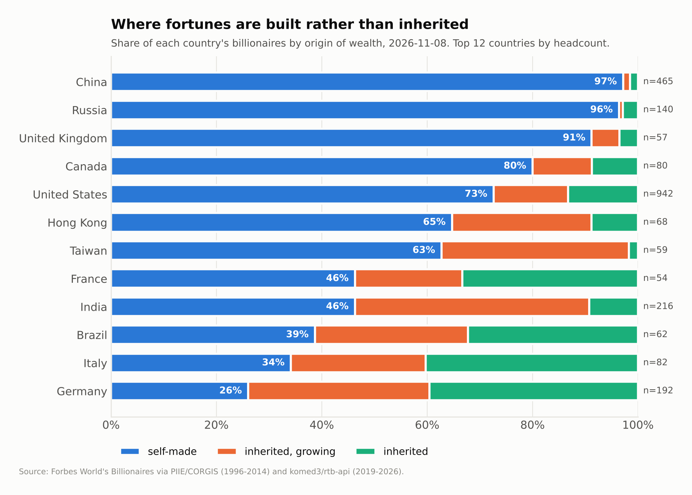
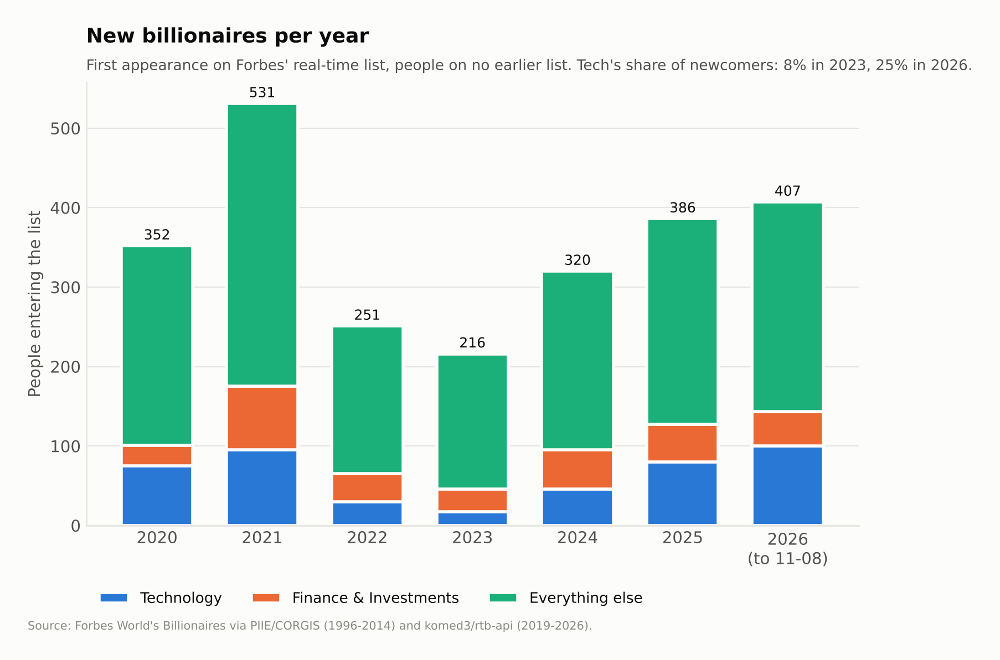
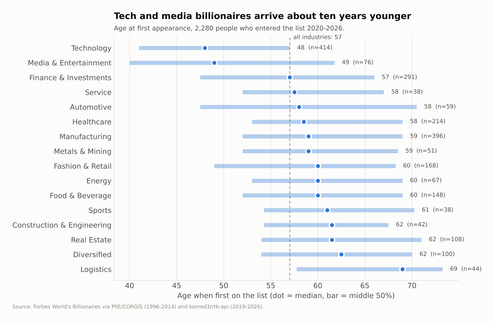
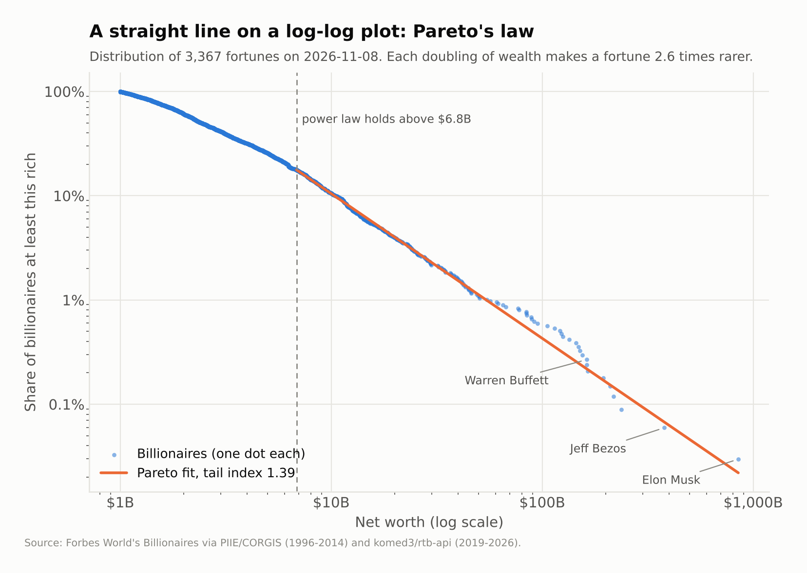
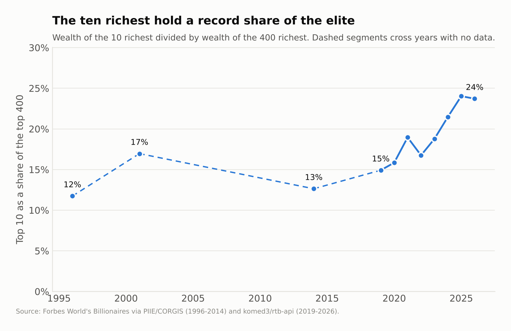
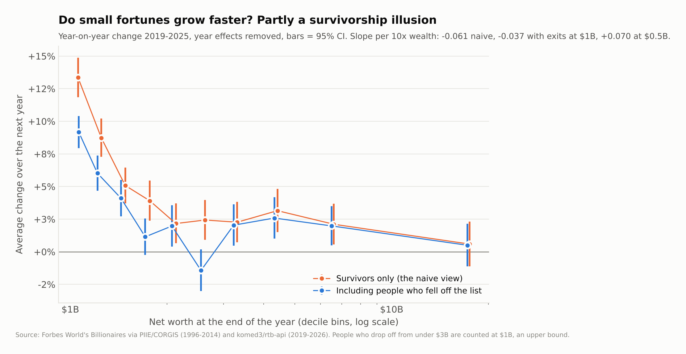
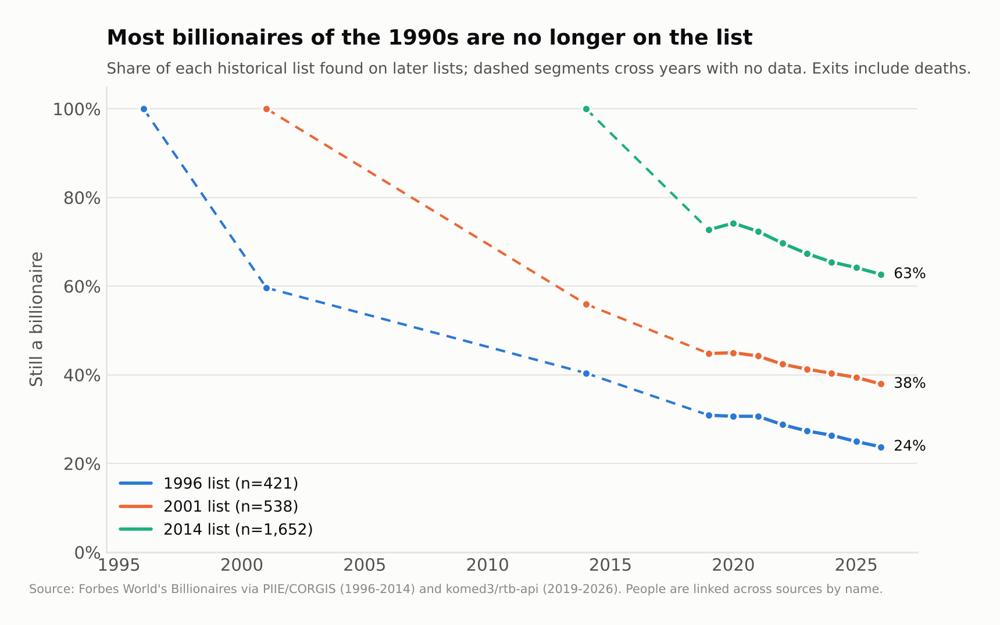

# Billionaire Atlas

**Who the world's billionaires are, when they got there, and how long they stay.**
5,535 people who have appeared on Forbes' billionaire lists between 1996 and November 2026,
built into one tidy, reproducible dataset and used to test a few claims people make about wealth.


---

## Headline findings

Snapshot: **8 November 2026** · 3,372 billionaires on the list · $20.1 trillion combined ·
81 countries. Every number below is regenerated by `make analyze`; the full set is in
[`reports/findings.md`](reports/findings.md).

| Question | Answer |
|---|---|
| How many billionaires built their fortune? | **67%** self-made today, up from 52% on the 1996 list. |
| Where is wealth mostly inherited? | Germany (26% self-made), Italy (34%), Brazil (39%). China and Russia are 96-97% self-made. |
| At what age do people first make the list? | Median **57**. Tech and media founders arrive about ten years earlier (48-49). |
| Is the distribution a power law? | Yes above ~$7B, with tail index **1.39** (95% CI 1.04-1.53). |
| Are the very richest pulling away? | The top 10 hold **24%** of the top 400's wealth, double the 12% of 1996. |
| Do small fortunes grow faster? | They appear to, but much of it is survivorship bias; the data cannot reject Gibrat's law. |
| How long does it last? | 24% of the 1996 list is still on the list in 2026. |

### 1. Built or inherited



The split tracks how old each country's private sector is. In China and Russia, where private
fortunes date from the 1990s, almost nothing has been inherited yet. Continental Europe's family firms (Germany's
*Mittelstand*, Italy's fashion houses) are on their third or fourth generation.

### 2. A new wave of founders



2,463 people joined the list from 2020 onwards without having been on any earlier list. 2021's
boom was broad-based. The share coming from technology fell to 8% in 2023 and has climbed to 25%
in 2026, with the youngest self-made entrants being 22-to-25-year-old AI founders.



### 3. Pareto's law, measured properly



The fit follows Clauset, Shalizi & Newman (2009): maximum likelihood for the exponent, the cut-off
chosen by minimising the Kolmogorov-Smirnov distance, and a 200-replicate bootstrap that re-selects
the cut-off each time. A tail index near 1.4 means each doubling of wealth makes a fortune about
2.6 times rarer.



The list grew from 423 people to over 3,000, and the top 10's share of a longer list falls for that
reason alone. Comparing against a fixed group, the 400 richest, removes the artefact and shows a
real rise since 2019.

### 4. Survivorship bias in action



**Gibrat's law** says a fortune's growth rate does not depend on its size. Regressing year-on-year
log growth on log wealth (2019-2025, year fixed effects, robust errors) gives a significantly
negative slope: smaller fortunes seem to grow faster.

That estimate only sees survivors. A $1.1B fortune that shrinks drops off the list and is never
observed again, so the small fortunes still in the sample are the ones that went up. Putting the
exits back in:

| Exits counted at | Slope per 10x wealth | t |
|---|---|---|
| dropped (naive) | −0.061 | −8.8 |
| $1.0B (an upper bound on what they kept) | −0.037 | −5.7 |
| $0.5B | +0.070 | +9.3 |

At least 39% of the naive effect is survivorship, and the sign of the rest depends on how far the
leavers fell, which the data does not record. The honest conclusion is that the data cannot
reject Gibrat's law.

### 5. Staying power



Of the 421 people on the 1996 list, 24% are still billionaires in 2026; for the 2014 list it is 63%.
Exits include deaths, where a fortune often passes to heirs who appear under their own names.

---

## Quick start

```bash
git clone https://github.com/atlafis/billionaire-atlas.git
cd billionaire-atlas
python -m venv .venv && source .venv/bin/activate   # Windows: .venv\Scripts\activate
pip install -e ".[dev]"

make analyze    # figures + report from the committed data, a few seconds
make all        # re-download the pinned raw data (~100 MB) and rebuild everything
make test
```

Without `make`, use `python -m billionaires fetch|build|analyze|all`. Add `--latest` to `fetch`
to pull the newest data instead of the pinned snapshot.

Explore in pandas:

```python
import pandas as pd
people = pd.read_csv("data/processed/billionaires.csv")

people.query("on_latest_list and country == 'Kazakhstan'")[["name", "source_of_wealth", "net_worth_latest_bn"]]
```

## How it is built

```
GitHub: corgis-edu/corgis ─┐                    ┌─ data/processed/billionaires.csv      one row per person
  Forbes 1996/2001/2014,   │   fetch    build   ├─ data/processed/net_worth_annual.csv  person × year
  annotated by PIIE        ├──────────►───────► ├─ data/processed/historical_lists.csv  list entries
GitHub: komed3/rtb-api ────┘ data/raw/          └──► analyze ──► reports/figures, reports/findings.md
  Forbes real-time list,
  one daily list per month
```

* **Sources are pinned to commits** (`src/billionaires/config.py`), so `make all` reproduces the
  committed results exactly. `data/processed/SOURCES.json` records what was fetched.
* **Who was a billionaire when** comes from 84 monthly snapshots of Forbes' real-time list
  (Nov 2019 - Nov 2026), not from per-profile summaries, which turned out to have gaps.
* **Duplicates.** Forbes sometimes re-files a person under a new URL (`liu-yonghao` /
  `yonghao-liu`). 294 such profiles are merged; namesakes who appear on the same list are kept apart.
* **Linking the eras.** The historical lists and Forbes profiles share no ID. Names are normalised
  (accents, suffixes, word order, nicknames like Jim/James and transliterations like
  Alexey/Alexei) and linked only when the match is unique. 81% of the 2014 list links.
* **Data the analysis does not need is not downloaded:** Forbes' biography text stays out.

Column definitions and known limitations: [`docs/data_dictionary.md`](docs/data_dictionary.md).

## Repository layout

```
src/billionaires/
  config.py     paths and pinned sources
  sources.py    download: sparse git checkout, compaction to two gzipped files
  names.py      name normalisation and conservative record linkage
  build.py      raw -> three tidy tables
  stats.py      Gini, Pareto MLE with KS cut-off and bootstrap, fixed-effects OLS
  analysis.py   one function per question, each returns numbers and draws one figure
  report.py     writes reports/findings.md
  style.py      shared chart style (colour-blind-safe palette)
tests/          unit tests on synthetic data with known answers, plus a miniature end-to-end build
```

## Caveats

* `first_seen_year` is the first year a person is **observed**, an upper bound on when they crossed
  $1B. Only people who enter after November 2019 have an exact year, which is why age-at-entry uses
  them alone.
* Forbes' net worth figures are estimates, especially for private companies.
* Self-made coding differs between PIIE (1996-2014) and Forbes (today), so the 52% → 67% comparison
  is indicative.
* All amounts are nominal dollars.

## Possible extensions

* Inflation-adjusted and GDP-relative wealth, so 1996 and 2026 fortunes compare like for like.
* Monthly return volatility and drawdowns per fortune, compared with the underlying stocks.
* Inheritance chains: linking deceased billionaires to the heirs who replace them on the list.

## Data and licence

Code: MIT. Data: compiled by Forbes; the 1996-2014 annotations are from Freund & Oliver,
*The Origins of the Superrich* (Peterson Institute for International Economics, 2016), via the
[CORGIS Dataset Project](https://corgis-edu.github.io/corgis/); the 2019-2026 lists are from the
MIT-licensed archive [komed3/rtb-api](https://github.com/komed3/rtb-api). This repository
redistributes only derived, factual fields for research and education.
